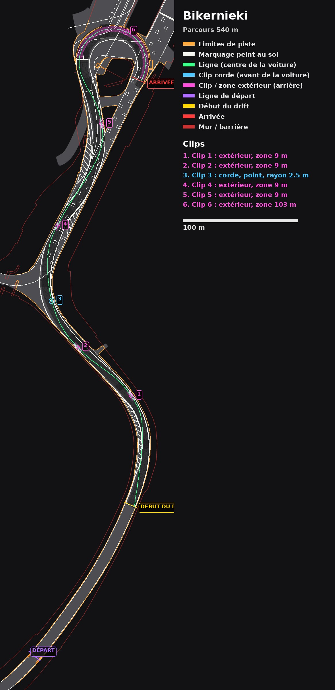
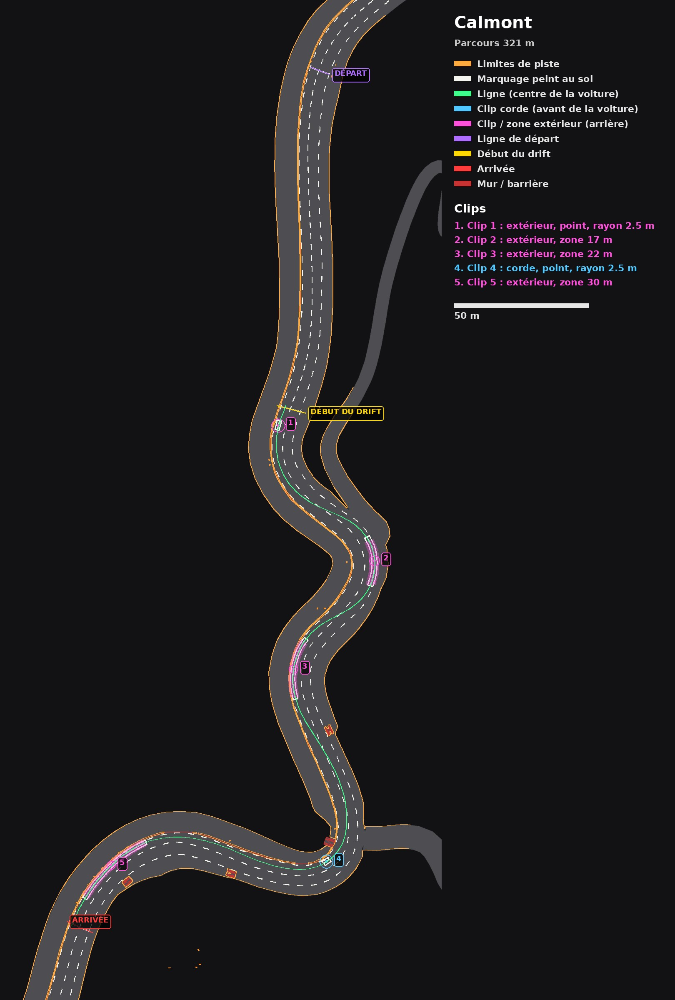
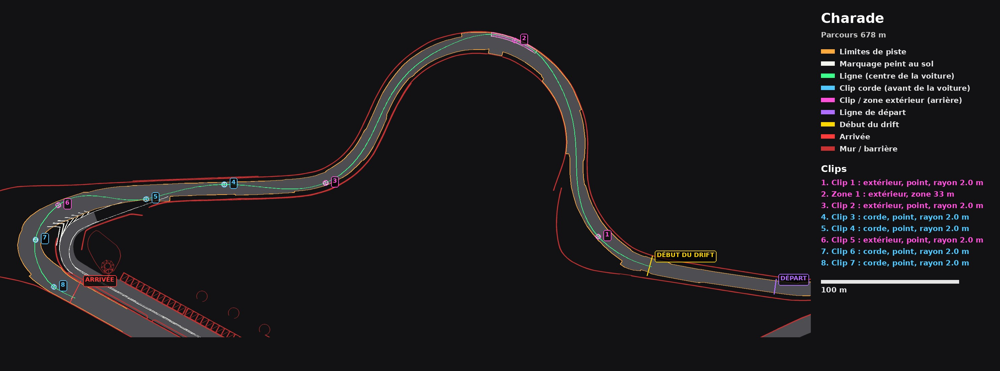
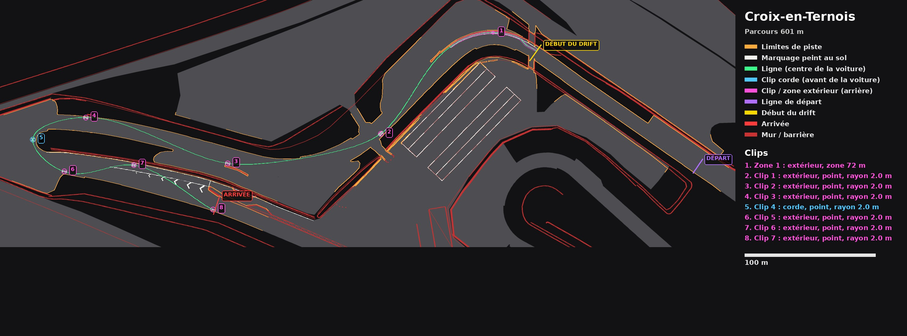
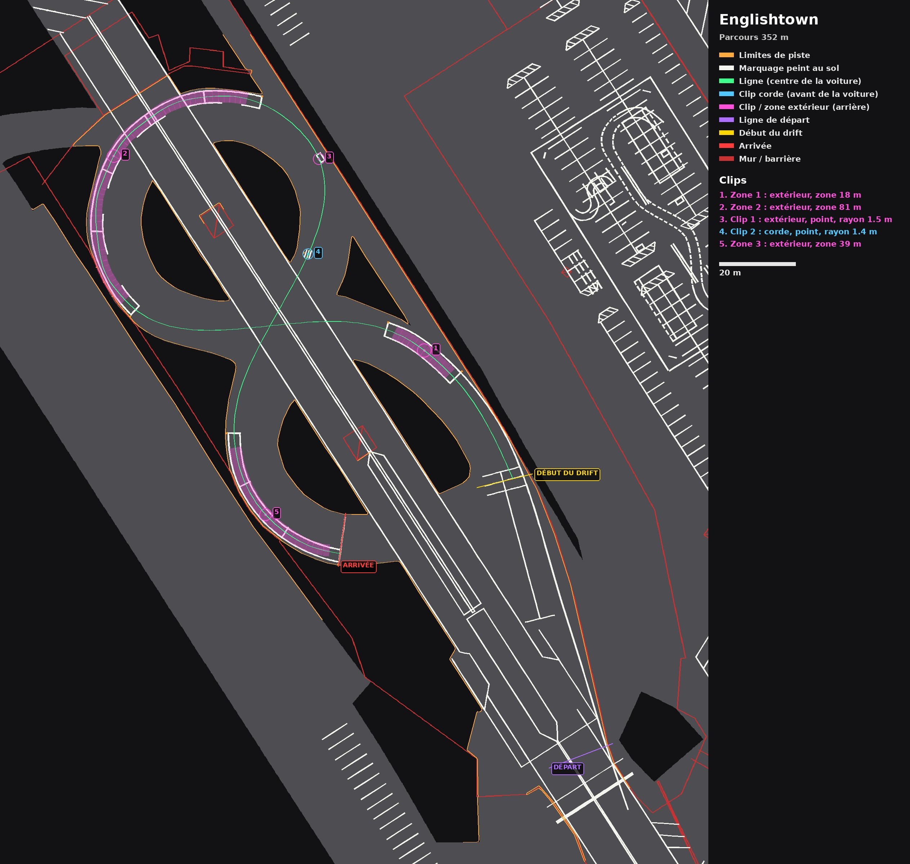
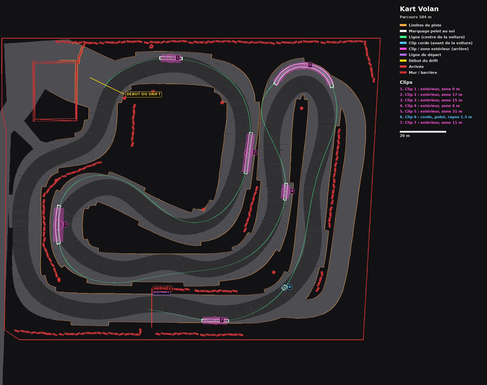
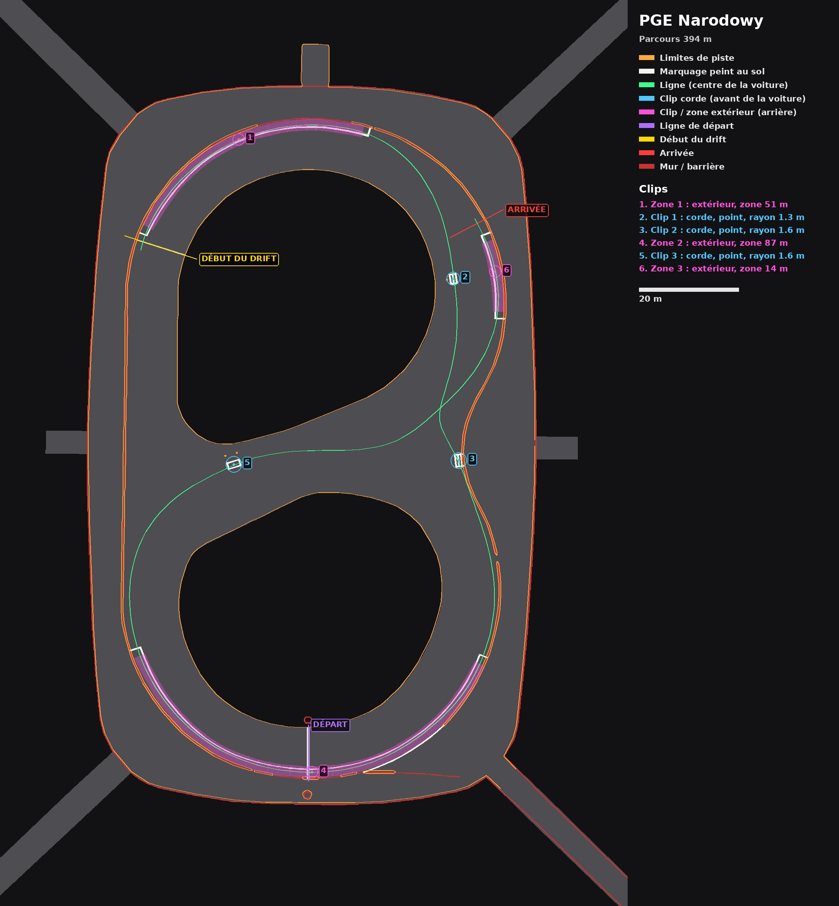
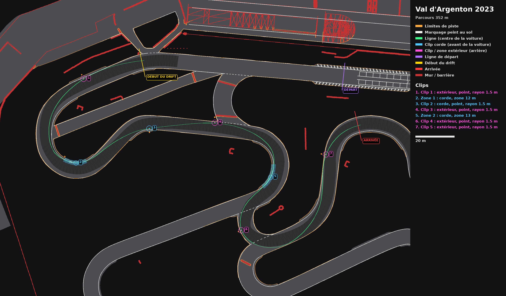
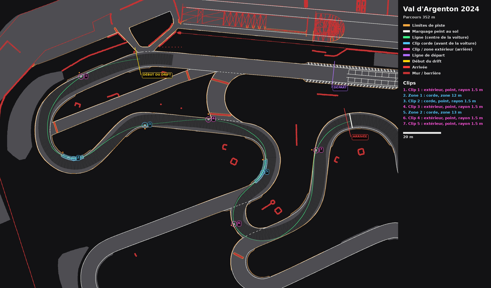
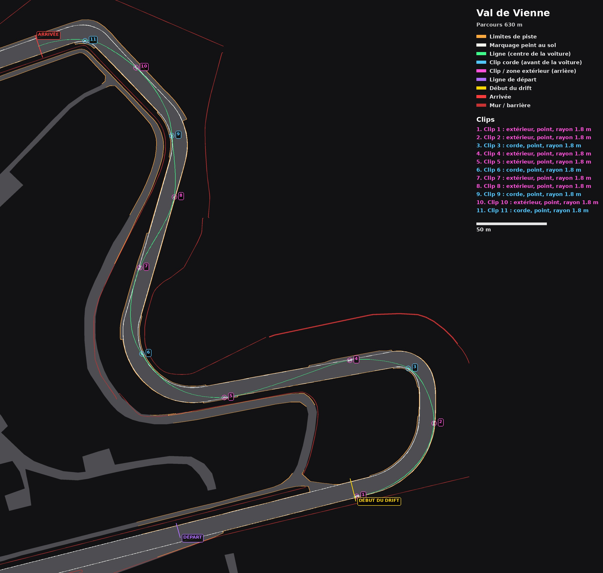

# Parcours officiels : images de contrôle

Une image par tracé, telle que le launcher l'utilise (v1.29.4) : limites de piste (orange), marquage
peint au sol (blanc), ligne de référence (vert), clips numérotés comme dans le launcher (bleu = corde,
rose = extérieur), départ (violet), début du drift (jaune), arrivée (rouge). Légende, liste des clips et
échelle à droite. Refaites avec `tools/track-analysis/poster.py`.

| Circuit | Image |
| --- | --- |
| Bikernieki |  |
| Calmont |  |
| Charade |  |
| Croix-en-Ternois |  |
| Englishtown |  |
| Kart Volan |  |
| PGE Narodowy |  |
| Val d'Argenton 2023 |  |
| Val d'Argenton 2024 |  |
| Val de Vienne |  |
